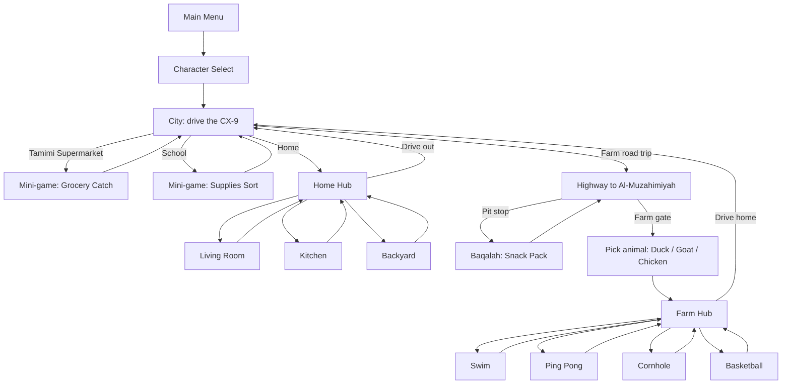

# Riyadh Kids Adventures — Game Design Document (v0.1)

*Working title.* A family-friendly, top-down driving + mini-game adventure based on
the daily life of three sisters in Riyadh, Saudi Arabia.

## 1. Vision

> "Hop in the blue Mazda CX-9 and spend a day in Riyadh with your sisters:
> shop at Tamimi, get to school, help at home, then take the road trip to the farm."

**Pillars**

1. **Always a win.** No fail states, no timers that punish. Every mini-game awards 1–3 stars; skipping is allowed.
2. **Drive to go anywhere.** The car is the menu. Every location is reached by driving.
3. **Mechanics change with place.** Car in the city → on foot/mini-game at school/home → animal avatar at the farm.
4. **Our own family, our own city.** Real places and personalities, shown warmly and respectfully.

**Audience:** ages ~5–12 (the sisters themselves) and parents who play along.
**Platform:** PC (Windows/Linux/macOS). Keyboard first, gamepad later. Session length 10–20 min.

## 2. Characters (player picks one per day)

| Character | Look | Personality | Gameplay perk (`Game.mod`) |
|---|---|---|---|
| **Daniah** | Glasses | Clever, observant | Items fall 15% slower (`slow_fall`), +1 puzzle hint (`hints`) |
| **Sarah** | Tallest, carries a book | Calm bookworm | Wider basket / longer reach (`catch_width`, `reach`) |
| **Lamia** | Youngest, animal lover | Playful, caring | Bonus helpers at the farm (`animal_bonus`), +5 s in timed games (`extra_time`) |

Perks are small on purpose: they make each sister feel different without making any choice "wrong".
All three can complete 100% of the content.

## 3. Core loop



**Micro loop (30–90 s):** drive → see a glowing zone → press **E** → mini-game → stars → back on the road.
**Macro loop (one "day", 10–20 min):** fill the daily checklist (Supermarket, School, Living Room, Kitchen, Backyard, Farm Fun) → day complete → sticker + unlocks.

## 4. Navigation: driving

* Top-down arcade driving (W/S throttle & brake/reverse, A/D steer, E to enter, Esc to menu).
* Soft collisions bleed speed; there is no damage. Walls at the map edge, buildings are solid.
* **City map:** 3×3 street grid. Home (SW), Tamimi (NW), School (NE), highway/farm exit (SE).
* **Farm highway:** a long straight road (~77 "km" on the HUD) with palms, a Baqalah pit stop halfway,
  a "Back to Riyadh" turn-around at the start and the farm gate at the end. Passing time is the
  "special longer sequence"; later add: sisters chatting, license-plate game, I-Spy, and camel/sheep crossings.
* HUD: character name, speed (km/h), distance to farm, daily checklist, contextual "Press E" prompt.

## 5. Locations & mini-games

Every mini-game extends `MiniGameBase`: intro → play → results (0–3 stars). Esc skips with 0 stars.

| Location | Mini-game | Rules (target design) | Perk hooks | Status |
|---|---|---|---|---|
| **Tamimi Supermarket** | Grocery Catch | 30 s. Move basket, catch dates/milk/bread/apples (+1), avoid soap (−1). 3★ ≥12, 2★ ≥7, 1★ ≥3 | Sarah wide basket, Daniah slow fall, Lamia +5 s | **Playable** |
| **School** | Supplies Sort | Drag pencils/books/notebooks into the right bags; quick riddle round | Daniah hints | Placeholder |
| **Home – Living Room** | Tidy-Up | Return scattered toys/cushions; find the hidden remote | Sarah reach for high shelves | Placeholder |
| **Home – Kitchen** | Kitchen Helpers | Follow a simple recipe (karak/dessert) by adding ingredients in order | — | Placeholder |
| **Home – Backyard** | Treasure Hunt | Find hidden items; pet-the-cat bonus | Lamia animal bonus | Placeholder |
| **Baqalah pit stop** | Snack Pack | 20 s grab-the-list-of-snacks into the trunk | Lamia +time | Placeholder |
| **Farm – Pool** | Pool Splash | Side-view swim, collect rings, dodge floaties | Duck `swim_speed` | Placeholder |
| **Farm – Ping Pong** | Rally | Keep a rally alive vs. a friendly AI; stars = rally length | Chicken `reflex` | Placeholder |
| **Farm – Cornhole** | Toss | Aim + power bar, 5 bags, stars by hits | Goat `jump` (strong throw) | Placeholder |
| **Farm – Basketball** | Hoops | Timed jump shot, 5 shots | Goat `jump` | Placeholder |

"Placeholder" = a SPACE-mash meter so the whole loop is playable today; each is swapped by editing
one line in `MiniGameRegistry`.

### Farm (Al-Muzahimiyah) — mechanics shift
At the gate the player **leaves the car** and picks an animal avatar (**Duck, Goat, Chicken**).
The animal is global state for the farm: `Game.animal_id`, with its own perks. The four farm
activities are reachable from a hub and can be repeated or the animal switched at any time.

## 6. Progression & rewards

* Stars (0–3 per mini-game, best kept). Daily checklist completes when every goal has ≥1★.
* Rewards (planned): car stickers/colour trims, license-plate frames, a photo-album of "memories" per location, new radio stations.
* Optional "family mode": two kids can alternate on one keyboard; the sister changes per day.
* Save: character, animal, best stars (`user://riyadh_kids_save.cfg`).

## 7. Difficulty & accessibility

* No fail states, generous hitboxes, 1★ is always reachable; Esc always leaves.
* Large UI text, high-contrast outlines; all functions work on keyboard alone (focus + Enter).
* Bilingual UI (English + Arabic) — Arabic needs bundled font + RTL review (Noto Sans Arabic / Naskh).
* Later: colour-blind-safe markers, reduced-motion option, hold-to-steer assist.

## 8. Art, audio, culture

* **Art:** bright flat vector style, warm desert palette (sand, turquoise, blue car). Replace `Portrait` shapes with real sprites.
  Recognisable landmarks (Kingdom Centre, Faisaliyah) used as skyline art.
* **Audio:** cheerful oud/percussion-inspired light music, car engine hum, mini-game stingers. All original or CC0.
* **Cultural care:** show daily life accurately and kindly; ask the family which details matter (dress, food, greetings).
* **Personal/privacy:** keep real names/photos local to your family copy; don't publish a build with real children's likenesses.
* **Trademarks:** for a private family build the CX-9 and Tamimi names are fine; for a public release use generic "blue SUV" / "Supermarket".

## 9. Technical design (implemented)

```
scripts/autoload/game_state.gd   Game   – data (characters, animals, locations, goals), progress, save, input map
scripts/autoload/scene_router.gd Router – fade transitions; enter_location / start_minigame / finish_minigame
scripts/driving/                 Car, LocationZone, DriveScene (base), CityScene, FarmHighwayScene
scripts/menus/                   main_menu, character_select, animal_select, home_hub, farm_hub
scripts/minigames/               MiniGameBase, MiniGameRegistry, host scene, catch_groceries, placeholder
scripts/ui/                      UIKit helpers, Portrait (placeholder art)
```

**Scene switching.** A driving scene never loads a mini-game itself. It calls
`Router.enter_location(id)`; the Router looks up `Game.LOCATIONS[id]` → either swaps to a scene key or
stores `Game.pending_minigame` + `Game.minigame_return` and loads `minigame_host.tscn`. When the mini-game
emits `finished(stars)` the Router records the result, saves, and returns to the stored scene.
`Game.spawn_id` puts the car back next to the place it just left.

**Adding content:** new location = add to `Game.LOCATIONS` + `add_zone()` in a map script;
new mini-game = new script extending `MiniGameBase` + one line in `MiniGameRegistry`.

## 10. Engine recommendation: **Godot 4 (GDScript)**

| | Godot 4 | PyGame | Unity |
|---|---|---|---|
| 2D scenes/UI, scene switching | Built-in, excellent | Hand-rolled | Good, heavy |
| Footprint / free / open | ~100 MB, MIT | Light, LGPL | Large, licensing |
| Gamepad, audio, export to PC/Web/mobile | Built-in | Manual | Built-in |
| Learning curve for a parent + kids | Gentle; Python-like | Gentle but you build everything | Steeper (C#) |

Godot's scene tree maps directly onto this design (each location is a scene), GDScript reads like Python,
and the result exports to Windows/Mac/Linux and Web. Use **PyGame only if the goal is for the kids to learn plain Python**.

## 11. Roadmap

1. **M0 – Foundation (this commit):** menu, character/animal select, city + highway driving, router, save, 1 playable + 9 placeholder mini-games.
2. **M1 – Polish the loop:** engine/ambient audio, real car & character art, day-complete screen, stickers.
3. **M2 – Mini-games #1:** School Sort, Baqalah Snack Pack, Living Room, Kitchen, Backyard.
4. **M3 – Farm:** swim, ping pong, cornhole, basketball with animal perks; farm return drive.
5. **M4 – Content & feel:** traffic, pedestrians, radio, Arabic font/RTL pass, gamepad, family playtest.

## 12. Risks

* Art volume → keep vector/flat; reuse shapes; let the kids draw assets.
* Scope creep → ship the placeholder loop first; replace one mini-game at a time.
* Arabic text rendering → test early with a bundled font.
